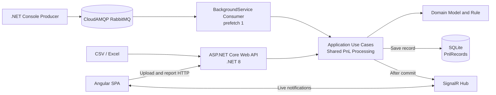
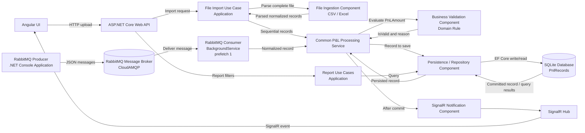

# Real-Time P&L Capture, Processing and Reporting

## Business problem and objective

The POC captures P&L records from two independent sources: start-of-day CSV/Excel uploads and a simulated real-time messaging feed. It applies one business rule, persists both valid and business-invalid records, and presents filtered reports that update in real time.

The key rule is:

| Condition | Classification | Persistence |
|---|---|---|
| `PnLAmount == 0` | Invalid | Persist with a validation reason |
| `PnLAmount != 0` | Valid | Persist |

Structural file errors are not business-invalid records. Missing headers, malformed rows, and values that cannot be parsed prevent a complete file from being processed. A zero P&L value is parseable and must be processed and persisted as invalid.

## Overall architecture

The backend is a Clean Architecture modular monolith hosted in one ASP.NET Core Web API process. The API handles file uploads and reports, while a hosted `BackgroundService` consumes RabbitMQ messages. Both paths invoke the same Application processing service. SQLite is the system of record. SignalR sends notifications only after a successful database commit.

The separate .NET Console Producer reads records from a local JSON file and publishes them periodically to CloudAMQP RabbitMQ. Angular loads reports through HTTP and receives live updates through SignalR.

## Technology stack

| Area | Technology | Purpose |
|---|---|---|
| Frontend | Angular, TypeScript, SignalR client | Upload, reporting grids, filters, live updates |
| API | ASP.NET Core Web API on .NET 8 | HTTP endpoints, hosting, SignalR hub |
| Architecture | Clean Architecture, modular monolith | Clear boundaries without distributed-service overhead |
| Persistence | EF Core and SQLite | Local, lightweight relational persistence |
| Messaging | CloudAMQP RabbitMQ | Delivery of individual real-time feed records |
| Consumer | ASP.NET Core `BackgroundService` | One sequential message consumer, prefetch 1 |
| Producer | Separate .NET Console application | Publish sample JSON records periodically |
| File support | CSV and Excel (`.xlsx`) | Start-of-day batch ingestion |
| Testing | xUnit and Moq | Unit and application/API integration tests |

## Building Block Architecture

Dependencies flow inward: Presentation and Infrastructure use Application abstractions; Application uses Domain; Domain remains independent. The Producer communicates through the RabbitMQ message contract and does not reference the backend's Domain project.

| Building block | Responsibility | Input | Output | Layer / boundary | Communication |
|---|---|---|---|---|---|
| Angular UI | Upload files; show valid/invalid grids, filters, counts, and live updates | User actions, report responses, SignalR events | Upload requests, report queries, rendered dashboard | Frontend | HTTP to Web API; SignalR connection to Hub |
| ASP.NET Core Web API | Accept uploads and report queries; host the SignalR endpoint and backend | Multipart file uploads, report filters | Import result/error response, report data | Presentation | Invokes Application use cases; maps SignalR Hub; returns HTTP responses |
| File Ingestion Component (CSV/Excel) | Parse the complete supported file and normalize rows; report structural errors | Uploaded CSV or `.xlsx` stream | Normalized records or structural errors | Infrastructure parser invoked by Application import use case | Web API invokes import use case; `IPnlFileParser` implementation parses; normalized inputs go to common processing |
| RabbitMQ Producer (.NET Console Application) | Read sample records from JSON and publish periodically | Local JSON data and broker configuration | Individual messages with stable `MessageId` | Separate executable / external producer | RabbitMQ client publishes to CloudAMQP |
| RabbitMQ Message Broker (CloudAMQP) | Buffer and deliver messages; provide retry/DLQ routing | Producer-published messages | Consumer deliveries, retry or DLQ routing | Managed external infrastructure | AMQP between Producer and hosted Consumer |
| RabbitMQ Consumer (BackgroundService) | Consume one message at a time, map the contract, and ACK/retry after processing | Broker delivery with `MessageId` | Processing call and ACK, retry, or DLQ route | Infrastructure hosted by API | AMQP to CloudAMQP; `IPnlProcessingService` in Application |
| Common P&L Processing Service | Apply shared orchestration, idempotency, persistence, and post-commit notification | Normalized record with `FeedType` and optional `MessageId` | Persisted record or explicit processing outcome | Application | Calls Domain validation, `IPnlRecordRepository`, then `IPnlRealtimeNotifier` after commit |
| Business Validation Component | Classify zero P&L as invalid and non-zero P&L as valid | `PnLAmount` (`decimal`) | `IsValid` and `ValidationReason` | Domain | Invoked by the Application processing service; returns classification |
| Persistence / Repository Component | Persist records and query reports; enforce unique messaging `MessageId` | `PnlRecord` writes and report filters | Commit result, persisted records, report rows/counts | Infrastructure implementing Application persistence port | EF Core repository uses SQLite; Application calls `IPnlRecordRepository` |
| SQLite Database | Store all valid and invalid P&L records | EF Core inserts and queries | Committed rows and query results | Infrastructure data store | Accessed only through the repository; one `PnlRecords` table |
| SignalR Hub and Notification Component | Notify connected dashboards about committed records | Persisted record notification | SignalR event to connected clients | Presentation Hub with Infrastructure notifier implementing Application port | Application calls `IPnlRealtimeNotifier`; implementation sends through Hub to Angular |

## CSV and Excel ingestion flow

1. A user selects and uploads a file in Angular.
2. The API selects the supported CSV or Excel parser.
3. The parser reads the complete file and maps rows to normalized inputs.
4. Missing headers, malformed rows, and unparseable values are structural errors. If present, the upload is rejected before any row is processed.
5. Once the entire file parses, records are sent sequentially to the shared Application processing service with `FeedType = File`.
6. Each record is classified and committed individually. Zero P&L is persisted as invalid.
7. After each successful commit, the service sends a SignalR event.
8. The API returns an import summary.

A database failure partway through sequential per-record processing can leave earlier records committed. File re-upload duplicate prevention is not included in the initial POC.

## RabbitMQ ingestion flow

1. The Console Producer reads sample records from JSON.
2. It publishes each record periodically to CloudAMQP with a stable `MessageId`.
3. The API's hosted consumer uses prefetch count 1 and processes deliveries sequentially.
4. The consumer maps the message to the common Application input with `FeedType = Messaging`.
5. The shared processing service applies the rule, checks `MessageId` uniqueness, and persists the record.
6. The consumer ACKs only after successful persistence (or after recognizing a previously persisted duplicate).
7. Transient failures use bounded retry; messages exceeding the retry limit are routed to a Dead Letter Queue (DLQ).

RabbitMQ connection credentials are supplied through .NET User Secrets during development or environment variables, not committed to source control.

## Common processing pipeline

Both file and messaging ingestion call the same Application processing service. The service validates normalized input, applies the Domain rule, assigns `FeedType`, `ProcessedAtUtc`, `IsValid`, and `ValidationReason`, and persists the record. Messaging records also have a stable `MessageId`; a unique database constraint provides the final idempotency safeguard.

`decimal` is used for financial calculations. The POC stores the decimal in a SQLite-compatible representation and performs the zero check in .NET. SQLite does not provide the same fixed-precision decimal behavior as a financial server database; database-side monetary aggregation and ordering are outside the initial scope.

## SignalR broadcasting flow

The processing service commits the record before sending a SignalR event. If notification delivery fails after the commit, the database record remains authoritative and is not rolled back. SignalR is not the system of record: Angular loads an HTTP snapshot initially and reloads reports after reconnecting to recover missed updates. The Outbox Pattern is explicitly deferred.

## Architecture decisions and rationale

- **Clean Architecture and modular monolith:** Preserve testable boundaries while keeping deployment and local operation simple.
- **Angular + ASP.NET Core Web API:** Separate the UI from backend APIs; MVC/Razor is not used.
- **SQLite + EF Core:** Lightweight local database suitable for the expected POC volume; its single-writer constraint is documented.
- **CloudAMQP RabbitMQ:** Provides actual broker-based ingestion without requiring Docker or local RabbitMQ.
- **One consumer, prefetch 1, sequential processing:** Limits concurrency and SQLite write contention during the POC.
- **Shared Application processing service:** Ensures file and message records use identical business validation and persistence logic.
- **Direct SignalR after commit:** Meets the live-update need with minimal initial infrastructure; missed notifications are recovered by report reload.
- **No outbox, Kafka, Redis, Kubernetes, or microservices:** Avoids infrastructure beyond the approved initial scope. The outbox and Kafka remain future considerations only.
