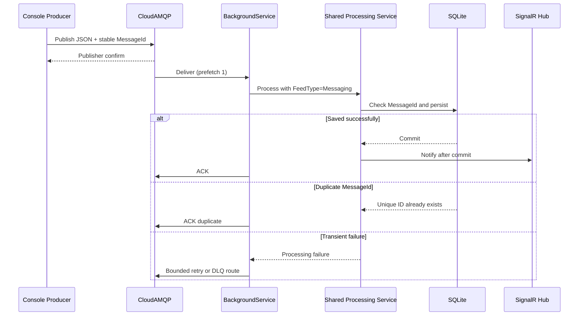
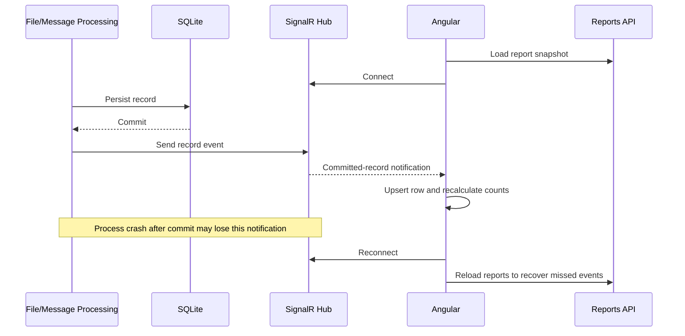

# Low-Level Design

## Clean Architecture layers

| Layer / project | Responsibility | Depends on |
|---|---|---|
| `PnlCapture.Domain` | P&L entity, feed type, and zero/non-zero validation rule | No application or infrastructure projects |
| `PnlCapture.Application` | Import, processing, and report use cases; ports/interfaces; DTOs | Domain |
| `PnlCapture.Infrastructure` | EF Core/SQLite, file parsers, RabbitMQ consumer, concrete notifier | Application and Domain |
| `PnlCapture.Api` | HTTP endpoints, SignalR hub, dependency registration, hosted consumer startup | Application and Infrastructure |
| `PnlCapture.Producer` | Read local JSON and publish messages to CloudAMQP | RabbitMQ client and message contract |
| Angular client | Upload files, query reports, display SignalR updates | Backend HTTP and SignalR contracts |

The Producer is a separate executable. It may define or share only the transport contract; it must not depend on backend domain entities.

## Proposed solution structure

```text
PnlCapture.sln
src/
  PnlCapture.Domain/
    Entities/
      PnlRecord.cs
    Enums/
      FeedType.cs
    Rules/
      PnlValidationRule.cs

  PnlCapture.Application/
    Abstractions/
      Files/
        IPnlFileParser.cs
      Notifications/
        IPnlRealtimeNotifier.cs
      Persistence/
        IPnlRecordRepository.cs
    Imports/
      ImportPnlFile/
        ImportPnlFileService.cs
        ImportPnlFileResult.cs
    Processing/
      ProcessPnlRecord/
        IPnlProcessingService.cs
        PnlProcessingService.cs
        PnlRecordInput.cs
    Reports/
      GetValidRecords/
      GetInvalidRecords/
      GetSummary/

  PnlCapture.Infrastructure/
    Files/
      CsvPnlFileParser.cs
      ExcelPnlFileParser.cs
    Messaging/
      RabbitMqConsumerService.cs
      RabbitMqTopology.cs
    Persistence/
      PnlDbContext.cs
      PnlRecordRepository.cs
      Configurations/
      Migrations/

  PnlCapture.Api/
    Controllers/
      ImportsController.cs
      ReportsController.cs
    Hubs/
      PnlHub.cs
    Notifications/
      SignalRPnlRealtimeNotifier.cs
    Program.cs
    appsettings.json

  PnlCapture.Producer/
    Contracts/
      PnlMessage.cs
    SampleData/
      pnl-records.json
    ProducerOptions.cs
    Program.cs

tests/
  PnlCapture.Domain.Tests/
  PnlCapture.Application.Tests/
  PnlCapture.Infrastructure.Tests/
  PnlCapture.Api.IntegrationTests/

client/
  pnl-capture-ui/
    src/app/
      core/
      features/
        imports/
        reports/
      shared/
```

`IPnlProcessingService` has one implementation, `PnlProcessingService`, and is used by both `ImportPnlFileService` and `RabbitMqConsumerService`. `PnlRecordInput` carries `SourceSystem`, `AccountNumber`, `PnLAmount`, `FeedType`, and an optional `MessageId`.

## Domain model and rule

### `PnlRecord`

Persisted properties:

- `Id`
- `SourceSystem`
- `AccountNumber`
- `PnLAmount` (`decimal`)
- `IsValid`
- `ValidationReason`
- `FeedType` (`File` or `Messaging`)
- `ProcessedAtUtc`
- `MessageId` (nullable; required for messaging records)

### Business rule

- If `PnLAmount == 0m`, set `IsValid = false` and a reason such as `PnL amount is zero`.
- Otherwise, set `IsValid = true` and no invalid reason.
- Both outcomes are persisted.

File structure errors are handled before records enter this rule. A zero value is not a parse error.

## Application interfaces and services

| Interface/service | Responsibility |
|---|---|
| `IPnlFileParser` | Parse a supported file completely and return normalized rows or structural errors |
| `IPnlProcessingService` | Apply the shared rule, enforce message idempotency, persist, then notify |
| `IPnlRecordRepository` | Save records and query reports/summary |
| `IPnlRealtimeNotifier` | Deliver a notification for a committed record |
| `ImportPnlFileService` | Coordinate full-file parsing, sequential processing, and import result |
| Report query services | Apply source/feed filters and return valid, invalid, and summary data |

The repository is backed by EF Core. Keep each write transaction short. The initial approach is one record per transaction; do not hold a database transaction while broadcasting SignalR.

## Infrastructure implementations

- `CsvPnlFileParser`: Read headers and rows, parse account number and decimal using the agreed input culture, and return structural errors with row locations.
- `ExcelPnlFileParser`: Read `.xlsx` content; proposed assumption is the first worksheet with a header row.
- `PnlDbContext` and `PnlRecordRepository`: Map `PnlRecord`, persist asynchronously, and provide report queries.
- `RabbitMqConsumerService`: ASP.NET Core `BackgroundService`; connect to CloudAMQP, configure the queue and prefetch 1, and invoke `IPnlProcessingService`.
- `SignalRPnlRealtimeNotifier`: Send the committed-record event through `IHubContext<PnlHub>`.
- `PnlHub`: SignalR endpoint for Angular clients.

RabbitMQ connection strings/credentials must come from User Secrets or environment variables. Do not commit credentials.

## Building block implementation and interface map

This map connects the HLD building blocks to their internal components, boundaries, and data flow.

| Building block | Internal component / interface | Layer / boundary | Input → output and communication |
|---|---|---|---|
| Angular UI | Import and report features; SignalR client | Frontend | File selection and report filters → HTTP requests; API results and SignalR events → rendered/upserted grid |
| ASP.NET Core Web API | `ImportsController`, `ReportsController` | Presentation | Multipart upload/report query → Application use cases; use-case results → HTTP response |
| File Ingestion Component (CSV/Excel) | `IPnlFileParser`, `CsvPnlFileParser`, `ExcelPnlFileParser` | Application port; Infrastructure implementations | Uploaded stream → normalized rows or structural errors; called by `ImportPnlFileService` |
| RabbitMQ Producer (.NET Console Application) | `PnlMessage`, producer `Program.cs` | Separate executable | Local JSON records → serialized messages with stable IDs; publishes via AMQP |
| RabbitMQ Message Broker (CloudAMQP) | Configured exchange/primary, retry, and DLQ queues | Managed external infrastructure | Published message → consumer delivery or bounded retry/DLQ routing |
| RabbitMQ Consumer (`BackgroundService`) | `RabbitMqConsumerService` | Infrastructure hosted by API | Broker delivery → `PnlRecordInput`; calls `IPnlProcessingService`; ACKs after commit or duplicate recognition |
| Common P&L Processing Service | `IPnlProcessingService`, `PnlProcessingService`, `PnlRecordInput` | Application | Normalized file/message input → rule evaluation, idempotency, repository save, and post-commit notifier call |
| Business Validation Component | `PnlValidationRule` | Domain | `PnLAmount` decimal → `IsValid` and `ValidationReason`; invoked by `PnlProcessingService` |
| Persistence / Repository Component | `IPnlRecordRepository`, `PnlRecordRepository`, `PnlDbContext` | Application port; Infrastructure implementation | Record save/report query → commit result or report rows/counts; repository uses EF Core |
| SQLite Database | `PnlRecords` table and indexes | Infrastructure data store | EF Core commands → persisted rows/query results; accessed through `PnlRecordRepository` |
| SignalR Hub and Notification Component | `IPnlRealtimeNotifier`, `SignalRPnlRealtimeNotifier`, `PnlHub` | Application port; Infrastructure notifier; Presentation hub | Committed record DTO → SignalR event sent through Hub to Angular; notifier is called only after persistence |

## API endpoints

| Method and route | Purpose |
|---|---|
| `POST /api/imports` | Upload one CSV or Excel file; return import counts or structural errors |
| `GET /api/reports/valid` | Query valid records; optional `sourceSystem` and `feedType` filters |
| `GET /api/reports/invalid` | Query invalid records; optional `sourceSystem` and `feedType` filters |
| `GET /api/reports/summary` | Return total, valid, and invalid counts, with optional filters |
| `/hubs/pnl` | SignalR connection endpoint |

Paging may be used for report grids; exact page limits remain an implementation decision.

## SQLite schema

Only one table is in the initial implementation: `PnlRecords`.

| Column | SQLite type | Constraints / use |
|---|---|---|
| `Id` | `INTEGER` | Primary key |
| `SourceSystem` | `TEXT` | Not null |
| `AccountNumber` | `INTEGER` | Not null |
| `PnlAmount` | `TEXT` | Not null; invariant-culture decimal representation |
| `IsValid` | `INTEGER` | Not null; boolean representation |
| `ValidationReason` | `TEXT` | Nullable |
| `FeedType` | `TEXT` | Not null; `File` or `Messaging` |
| `ProcessedAtUtc` | `TEXT` | Not null; UTC timestamp |
| `MessageId` | `TEXT` | Nullable; stable ID for messaging records |

Indexes:

- Unique partial index on `MessageId` where it is not null.
- Index on `(IsValid, ProcessedAtUtc)` for report selection.
- Index on `(SourceSystem, FeedType, ProcessedAtUtc)` for filtering.

SQLite does not offer SQL Server-style fixed-precision decimal semantics. The POC stores the decimal's invariant textual form and performs the zero comparison in .NET. Do not use SQLite numeric ordering/aggregation for P&L. If exact database calculations become necessary, agree on a fixed scale and consider scaled integer storage or a database with fixed-precision decimal support.

## RabbitMQ message contract

The producer publishes one JSON object per message:

```json
{
  "messageId": "stable-unique-id",
  "sourceSystem": "SampleTradingSystem",
  "accountNumber": 123456,
  "pnlAmount": 1250.75
}
```

`messageId` is stable for the logical message and remains unchanged across retries/redelivery. The consumer sets `FeedType = Messaging`; `FeedType` is not trusted from the message payload. JSON P&L values must deserialize to `decimal`.

The Producer's treatment of repeated sample rows is an unresolved choice: if it republishes the same logical records, their IDs must remain the same (and later deliveries will be duplicates); if it simulates new events, it must assign new stable IDs per event.

## Producer and consumer responsibilities

### Console Producer

- Read the configured local JSON sample file.
- Publish records periodically to CloudAMQP.
- Include a stable `MessageId`.
- Use publisher confirms and report connection/publish failures.
- Read broker credentials from environment variables or a local development secret store.

### Background consumer

- Run inside the API as a hosted `BackgroundService`.
- Use one consumer with prefetch count 1.
- Deserialize and minimally validate the message contract.
- Call `IPnlProcessingService` with `FeedType = Messaging`.
- ACK only after persistence succeeds. ACK a recognized duplicate without inserting it again.
- On transient failure, use bounded retry; route exhausted/permanent failures to the DLQ.

## File processing policy

1. Accept only the configured CSV and Excel formats and enforce an upload-size limit.
2. Parse the complete file before invoking the processing service.
3. Treat missing headers, malformed rows, and unparseable values as structural errors. Return explicit row-level details and process no rows if the file is structurally invalid.
4. Once parsing succeeds, process records sequentially as `FeedType = File`.
5. A successfully parsed zero P&L row is business-invalid but is persisted.
6. A database failure during processing can leave earlier per-record commits in place.
7. File re-upload duplicate prevention is not in the initial scope.

## Idempotency, retry, and DLQ

For messaging ingestion, enforce uniqueness with a database unique index on non-null `MessageId`. The unique constraint is authoritative in case of redelivery or a race; treat a duplicate as already processed and ACK it. The producer must supply a stable ID.

Use a bounded retry route and a DLQ rather than unlimited immediate requeue. A practical simple topology is a primary queue, a retry queue with a delay/TTL and dead-letter routing back to the primary queue, and a final DLQ after a configured retry limit. Confirm CloudAMQP plan support for queue policies/TTL before implementation. Retry count and delay remain configuration decisions. A poison/malformed message should not be retried indefinitely.

## SignalR event contract

After persistence commits, publish a small event containing the persisted data required for an upsert:

```json
{
  "id": 42,
  "sourceSystem": "SampleTradingSystem",
  "accountNumber": 123456,
  "pnlAmount": 1250.75,
  "isValid": true,
  "validationReason": null,
  "feedType": "Messaging",
  "processedAtUtc": "2026-11-06T12:00:00Z",
  "messageId": "stable-unique-id"
}
```

The hub event is a notification, not durable storage. Angular should upsert by `id`, and reload reports after SignalR reconnection. If a broadcast fails after commit, do not roll back the record. An Outbox Pattern is a future enhancement, not initial scope.

## Sequence diagrams

### File ingestion

```mermaid
sequenceDiagram
    actor User
    participant UI as Angular
    participant API as Imports API
    participant Parser as CSV/Excel Parser
    participant Import as Import Use Case
    participant Process as Shared Processing Service
    participant DB as SQLite
    participant Hub as SignalR Hub

    User->>UI: Upload file
    UI->>API: POST /api/imports
    API->>Parser: Parse entire file
    alt Structural error
        Parser-->>API: Header/row/value errors
        API-->>UI: Reject file; no rows processed
    else Parse succeeds
        Parser-->>Import: Normalized records
        loop Sequentially per record
            Import->>Process: Process with FeedType=File
            Process->>Process: Apply PnL rule
            Process->>DB: Save record
            DB-->>Process: Commit
            Process->>Hub: Notify after commit
        end
        Import-->>API: Import summary
        API-->>UI: Counts and result
    end
```

### RabbitMQ ingestion



### SignalR updates and recovery



## Testing approach

### Unit tests

- xUnit Domain tests for zero, positive, and negative non-zero values.
- xUnit Application tests for feed assignment, reasons, persistence orchestration, duplicate-message behavior, and summaries.
- Moq for repository and notifier ports in Application tests.
- Parser tests for missing headers, malformed rows, unparseable values, and valid zero P&L.

### Integration tests

- Use a temporary file-backed SQLite database to verify schema, unique `MessageId`, persistence, and transactions.
- API tests for upload, structural-error responses, valid/invalid reports, and filters.
- RabbitMQ integration tests against CloudAMQP or a separately approved test broker configuration for publish/consume, ACK, retry, and DLQ behavior.
- SignalR test for post-commit event delivery and Angular/client reconnect snapshot recovery.
- Verify that a database failure partway through a file can leave earlier records committed, as documented.
